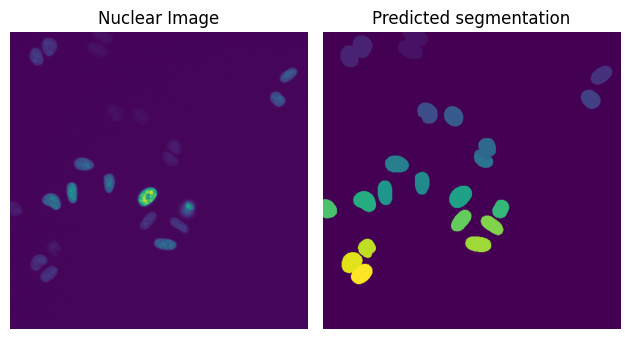

# Torch DNN

A PyTorch version of **DynamicNuclearNet** (DNN), the deep learning model from the
Van Valen lab's [`deepcell-tf`](https://github.com/vanvalenlab/deepcell-tf) that finds
cell nuclei in fluorescence images (for example, live-cell time-lapse movies used for
cell tracking). Give it an image of a nuclear stain and it returns a *label mask*: an
image in which every nucleus is filled with its own number (1, 2, 3, ...) and the
background is 0.

This package rebuilds deepcell's `NuclearSegmentation` application and its training
recipe in PyTorch, as closely as the two libraries allow. Its sibling,
[torch-mesmer](https://github.com/vanvalenlab/torch-mesmer), does the same for Mesmer.

> **No trained weights are shipped yet.** The network was rebuilt in November 2026 to
> match deepcell exactly, so weights trained with earlier versions of this package
> (for example `~/.deepcell/dnn/saved_model_best_dict.pth` or
> `~/.deepcell/models/dnn/saved_model_best_dict.pth`) **cannot be loaded any more** —
> loading them stops with an error that says so. Train a new model first
> ([Training](#training)), then re-tune the post-processing for it
> ([Evaluation](#evaluating-a-model-and-tuning-post-processing)).

More detail: [doc/tutorial.md](doc/tutorial.md) (segmenting your own images),
[doc/training.md](doc/training.md) and [doc/evaluation.md](doc/evaluation.md).

## Installation

Python 3.10 or newer. From a copy of this repository, inside a virtual environment:

```bash
pip install -e .            # the package
pip install -e ".[test]"    # also installs pytest, to run the tests
```

A GPU is needed for training and strongly recommended for segmenting more than a
handful of images.

## Quick start: segment the example image

`example/example_image.tiff` is a 512 x 512 nuclear image. With trained weights
(see [Using your trained weights](#using-your-trained-weights)):

```python
import numpy as np
import matplotlib.pyplot as plt
from tifffile import imread
from torch_dnn.dnn import DNN

app = DNN()                          # newest ~/.deepcell/models/torch-dnn*.pth; or DNN(model_path='...')
frame = imread('example/example_image.tiff')      # (512, 512)

# The network expects (frames, channels, height, width): add the two missing axes.
masks = app.predict(frame[np.newaxis, np.newaxis], image_mpp=0.65)
masks.shape   # (1, 1, 512, 512); 0 = background, 1..N = nuclei

fig, ax = plt.subplots(1, 2)
ax[0].imshow(frame, cmap='gray'); ax[0].set_title('Nuclear image')
ax[1].imshow(masks[0, 0], cmap='nipy_spectral', interpolation='nearest'); ax[1].set_title('Predicted nuclei')
for a in ax:
    a.set_axis_off()
plt.show()
```



(The figure was made with an earlier model; a new model gives similar masks.)

Things to know:

- **`image_mpp` is the pixel size in microns per pixel, and it is required.** The
  network was trained at 0.65 µm/pixel; images at other sizes are scaled to 0.65 before
  segmentation and the masks are scaled back, so the output always matches your
  input. Pass `image_mpp=None` only if your images are already at 0.65.
- **Images must be "channels first", with exactly one channel**: `(frames, 1, height,
  width)`. A time-lapse movie stored as `(frames, height, width)` becomes
  `movie[:, np.newaxis]`. Every frame is segmented on its own.
- Any image size works: images are cut into overlapping 256 x 256 tiles and stitched.
- `DNN(device='cuda:0')` picks a device (default: a GPU if there is one). On a shared
  server, choose the physical GPU with `CUDA_VISIBLE_DEVICES` before starting Python.
- `torch_dnn` does not limit CPU threads by itself; on a shared machine call
  `torch.set_num_threads(4)` (or similar) first.

[doc/tutorial.md](doc/tutorial.md) covers movies, the raw network output and changing the
post-processing settings.

## Getting the data

The model is trained and tested on the **DynamicNuclearNet segmentation dataset,
release v1.0** (`DynamicNuclearNet-segmentation-v1_0.zip`, from deepcell). Unzip it so
that `train.npz`, `val.npz` and `test.npz` are in `~/.deepcell/dnn/`, then convert them
once to the Zarr format the code reads:

```bash
nice -n 10 python -m torch_dnn.preprocess
# reads  ~/.deepcell/dnn/{train,val,test}.npz
# writes ~/.deepcell/dynamic_nuclear_net/{train,val,test}.zarr
```

Options: `--source-dir`, `--out-dir`, `--splits test` (only some splits), `--overwrite`.
Nothing is dropped or resized:

| Split | Images (512 x 512) | Cell lines |
|---|---|---|
| train | 4950 | HeLa, RAW264, 3T3, HEK293, PC-3, RPE |
| val | 1417 | same |
| test | 717 | same |

Most images are 0.65 µm/pixel. The **PC-3** images are 0.55 µm/pixel and the **RPE**
images have no recorded pixel size; see
[Differences from the TensorFlow version](#differences-from-the-tensorflow-version).

## Training

```bash
export CUDA_VISIBLE_DEVICES=4          # the one GPU you are allowed to use
nice -n 10 python -m torch_dnn.train   # 16 epochs, batch size 16: about 30 minutes
```

This follows deepcell's DynamicNuclearNet training notebook (Adam, learning rate 1e-4
decaying by 1% per epoch, batch size 16, 16 epochs, random 256 x 256 crops with
rotation, flips and zoom). Each run gets a time-stamped folder in the folder you
started it from:

```text
data/model/<timestamp>/saved_model_best_dict.pth   # weights with the lowest validation loss (use these)
data/model/<timestamp>/last_model_dict.pth         # weights after the last epoch
data/logs/<timestamp>/                             # history.jsonl, run_config.json, TensorBoard logs
```

On an RTX 6000 Ada one epoch takes about 100 seconds and needs about 17 GB of GPU
memory. Options, monitoring and what the numbers mean: [doc/training.md](doc/training.md).

### Using your trained weights

Either pass the file to the app, `DNN(model_path='data/model/<timestamp>/saved_model_best_dict.pth')`,
or make it the default by copying it into `~/.deepcell/models` with a dated name
(the same convention as `torch-mesmer_<date>.pth`):

```bash
cp data/model/<timestamp>/saved_model_best_dict.pth ~/.deepcell/models/torch-dnn_2026-11-20.pth
```

`DNN()`, `torch_dnn.eval` and friends then use the newest `torch-dnn*.pth` in that
folder (newest by the date in the name). Training prints this command, with the
right paths, when it finishes.

## Evaluating a model and tuning post-processing

**Score a model on the test split** (717 images, a few minutes on a GPU):

```bash
python -m torch_dnn.eval --model-path data/model/<timestamp>/saved_model_best_dict.pth --device cuda
```

It prints recall, precision and F1 (pooled over all images, as deepcell reports them)
for all images and for each cell line, and writes `eval_results_<time>.csv` (one row per
image) and `eval_summary_<time>.csv` to the current folder. `--limit 20` scores only the
first 20 images, for a quick check.

**Re-tune post-processing after training.** The network does not output masks directly:
it predicts two "distance" maps, and a watershed step turns them into masks. That
step's settings (`DEFAULT_POSTPROCESS_KWARGS` in `torch_dnn/dnn.py`) are still the ones
deepcell tuned for *its* TensorFlow weights. After training, search for better ones on
the validation split:

```bash
python -m torch_dnn.postprocess_sweep cache --model-path <weights.pth> --out data/sweep/cache_val
python -m torch_dnn.postprocess_sweep sweep --cache data/sweep/cache_val --grid grid.json --out data/sweep/results.csv
```

The first command runs the network once over the validation images; the second tries
every combination of settings in `grid.json` without rerunning the network. Details,
an example grid and how to use the winning settings: [doc/evaluation.md](doc/evaluation.md).

## The network

DynamicNuclearNet is a "panoptic" network, as built by deepcell's `PanopticNet`:

1. **Input**: one nuclear channel. Two extra channels holding each pixel's x and y
   position are added, and a 1 x 1 convolution turns the three into the three channels
   the backbone expects.
2. **Backbone**: EfficientNetV2-L (`efficientnetv2bl`), which picks out image features
   at five scales (`C1`–`C5`, from 1/2 to 1/32 of the image size). Training starts from
   ImageNet weights, as in deepcell.
3. **Feature pyramid** (`P1`–`P7`): combines the coarse and fine features.
4. **Three heads**, each reading the finest pyramid level (`P1`) and producing a map at
   the input's resolution (256 x 256 per tile):

```text
Output channel 0   Head 1: inner distance   how far a pixel is inside its nucleus (high at the centre)
Output channel 1   Head 2: outer distance   distance to the nucleus edge (above 0 anywhere inside a nucleus)
Output channels 2-3  Head 3: fgbg           probability of background (2) and of foreground (3)
```

The network returns all four channels together, `(batch, 4, 256, 256)`. To make masks
(deepcell's `deep_watershed`), the peaks of the inner distance become one seed per
nucleus, and a watershed from those seeds fills the area where the outer distance is
above a threshold. The foreground/background head helps training but is not used to
make masks, as in deepcell.

About 119 million parameters. Every checkpoint stores an `arch_version` number
(currently 3); weights from older versions of this package have none and are refused
with an explanation.

### How it is trained

Loss: mean squared error for each distance head, plus 0.01 x a class-weighted
cross-entropy for the foreground/background head, summed. Images are normalised
with CLAHE (contrast-limited adaptive histogram equalisation) before cropping. The
model kept is the one with the lowest validation loss. See
[doc/training.md](doc/training.md) for the full recipe.

## Differences from the TensorFlow version

The port aims to give the same results as deepcell-tf, and the tests compare it
against deepcell's own code wherever possible. Where it differs, or where deepcell's
behaviour is surprising, this is what to know:

- **The "reduce learning rate on plateau" step works here; in deepcell it did not.**
  The notebook adds a callback that should cut the learning rate 10x when validation
  loss stalls for 5 epochs, but in TensorFlow 2.8 the per-epoch learning-rate schedule
  overwrites that cut before the next epoch. This port keeps the cut (the 0.99-per-epoch
  decay continues from the lower rate); `history.jsonl` records each cut (`plateau_lr`).
- **Validation uses a fixed centre crop.** deepcell takes a new random 256 x 256 crop
  of each validation image every epoch; this port always takes the centre, so the
  validation loss can be compared from epoch to epoch.
- **Zoom is done by cropping, not by shrinking a crop.** For a random zoom, deepcell
  first cuts a 256 x 256 crop and then zooms it, so zooming out leaves an edge border
  filled with repeated pixels. This port cuts a larger or smaller region from the
  512 x 512 image and resizes it to 256 x 256, so zoomed-out samples show real image
  instead of filled borders. The zoom range (0.75–1.33) and rotations and flips are the
  same.
- **Image resizing matches deepcell's.** Scaling images to 0.65 µm/pixel and masks back
  uses OpenCV (`cv2.resize`), as deepcell-toolbox does, so the same image gives the same
  resized input.
- **Pixel sizes in the dataset.** PC-3 images are 0.55 µm/pixel and RPE images have no
  pixel size. As in deepcell, training uses every image at its stored size without
  rescaling. `torch_dnn.eval` rescales PC-3 test images from 0.55 to 0.65 and leaves RPE
  images as they are (treated as 0.65).
- **Batch normalisation, start-up weights and the network's wiring** follow Keras's
  defaults and deepcell's code, rather than PyTorch's.

## Tests

```bash
pytest                                # all tests, about a minute on CPU
pytest -m "not slow and not data"     # the quick ones only (about 15 seconds)
```

Tests marked `data` need the Zarr files in `~/.deepcell/dynamic_nuclear_net/` and are
skipped without them. Many tests compare the port against deepcell's own code in
`./deepcell-tf` and `../torch-mesmer/deepcell-toolbox`, and are skipped if those copies
are missing.
